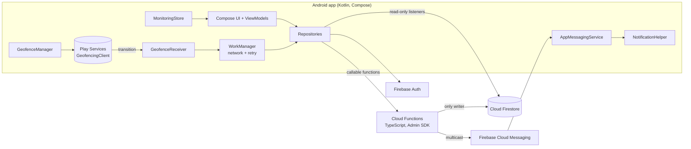

# Orbit

**A quieter way to keep a group together.** Orbit is an Android app for friends, travellers and small groups.
Draw a boundary on a map, invite people with a code, and everyone else is notified when a member leaves it or comes back.
It tells the group *that* someone crossed — never *where* anyone is.

> **Status: built, not yet run on a device.** The backend logic and the pure-Kotlin domain logic are unit-tested.
> The Android app has not been compiled in CI or run on hardware yet, and no Firebase project has been connected.
> See [docs/TEST_REPORT.md](docs/TEST_REPORT.md) for exactly what is and isn't verified.

## Features
- Email/password accounts (Firebase Auth), onboarding, password reset
- Create groups; invite with a unique 6-character code; join with a code; leave a group
- Circular boundary set on a custom-styled Google Map (tap, current location, or typed coordinates; 100 m – 5 km)
- Roles: owner and admins can edit the boundary; only the owner promotes admins
- **Group Pulse**: inside / outside / not-reported summary and the latest crossing — labelled as last-known, never live
- **Monitoring status** for *this* phone: active · permission missing · unavailable · out of date · not confirmed
- **Activity timeline** grouped by day, with exits emphasised
- Push notification to every *other* member on exit and on re-entry; the person who crossed is never notified
- Settings: step-by-step permissions (incl. "Allow all the time" and battery), privacy summary, sign out

## Screenshots
Screenshots are captured from a real device, not mocked up. None have been captured yet; after your first run:

```bash
scripts/capture-screenshots.sh home      # repeat for: group, boundary, settings, notification
```
then add `` etc. here.

## Architecture


### Geofence-exit notification flow
```mermaid
sequenceDiagram
  autonumber
  participant A as Member A's phone
  participant PS as Play Services
  participant W as WorkManager
  participant F as reportGeofenceEvent
  participant DB as Firestore
  participant M as FCM
  participant B as Member B's phone
  A->>PS: addGeofences (on app open, boot, FCM sync, every 6 h)
  PS-->>A: EXIT transition (works with app closed)
  A->>W: enqueue report (per-group ordered chain, needs network)
  W->>F: groupId, ENTER/EXIT, lat/lng, clientTime (Firebase ID token)
  F->>DB: transaction: caller is member? fence exists? position plausible? state actually changed?
  alt duplicate / stale / implausible
    F-->>W: ignored or rejected (no notification)
  else real change
    F->>DB: update member state + group pulse; write event (who, when — no coordinates)
    F->>M: send to all member devices except A (retry transient errors, prune dead tokens)
    M-->>B: "<name> exited the boundary"
    B->>DB: timeline updates via live listener
  end
```

### Key decisions
- **Clients never write** groups, members, events or invite codes. `firestore.rules` denies it; only Cloud Functions (Admin SDK) write. Invite codes are stored in a private group subdocument and fetched through a role-checked callable, so ordinary members cannot read or share them. If you deployed an earlier build, migrate existing group documents by moving their `inviteCode` field to `groups/{groupId}/private/invite.code` before using this version.
- **Server-side dedupe**: each member's `insideGeofence` is stored; a report that doesn't change it is ignored.
- **Server-side actor exclusion**: recipients = group members minus the caller, so multi-device users are safe too.
- **Native geofencing, no GPS polling.** The phone does nothing until Play Services reports a crossing.
- **Pure logic is isolated** (`domain/`, `functions/src/logic.ts`, `notify.ts`) so it can be unit-tested without Android or Firebase.

### Project layout
```
app/src/main/java/com/example/geofencegroups/
  domain/        pure Kotlin: monitoring state, presence, pulse headline, time formatting   (unit-tested)
  data/          Firebase repositories, models, prefs
  geofence/      GeofenceManager, receiver, WorkManager workers, MonitoringStore, boot receiver
  push/          FCM service, notification channel
  permissions/   permission checks
  ui/            screens, ViewModels, navigation
  ui/theme/      Orbit tokens (colour, type, spacing)
  ui/components/ buttons, cards, Group Pulse, monitoring banner, activity timeline, map
functions/       Cloud Functions (TypeScript) + unit tests
firestore.rules  security rules      firestore-tests/  rules tests (emulator)
```

## Setup
Prereqs: Android Studio (stable), JDK 17, Node 20, Firebase CLI (`npm i -g firebase-tools`), a real Android phone with Google Play services.

**1. Firebase** (console.firebase.google.com)
1. Create a project and upgrade to **Blaze** (required for Cloud Functions; usage here is far inside the free tier — set a budget alert).
2. Authentication → enable **Email/Password**.
3. Firestore → create a database (production mode).
4. Add an Android app, package `com.example.geofencegroups` (change it everywhere if you rebrand), and download `google-services.json` into `app/`. **It is git-ignored; don't commit it.**
5. FCM needs no extra key: Cloud Functions send through the Admin SDK with the project's default service account. Do **not** create or commit service-account JSON files.

**2. Google Maps**: in Google Cloud, enable *Maps SDK for Android*, create an API key, restrict it to your package name + debug SHA-1 (`./gradlew signingReport`), then put it in `local.properties` (git-ignored):
```
MAPS_API_KEY=your_key_here
```
Without a key the map is blank but the app still works via coordinates / current location.

**3. Backend**
```bash
firebase login
firebase use --add                       # choose your project
cd functions && npm ci && npm test && cd ..
firebase deploy --only firestore:rules,firestore:indexes,functions
```

**4. Android**: open the folder in Android Studio (it downloads Gradle 8.9 from `gradle-wrapper.properties`), sync, run on a device.
CLI: `./gradlew :app:testDebugUnitTest :app:lintDebug :app:assembleDebug` (Windows: `gradlew.bat :app:testDebugUnitTest :app:lintDebug :app:assembleDebug`). The repository includes a small bootstrap launcher that downloads the pinned Gradle 8.9 distribution on first use; this requires an internet connection. Android Studio also needs access to Google Maven and the Android SDK. The launcher does not replace the Android SDK or Firebase setup requirements.

## Build & test commands
| What | Command |
|---|---|
| Cloud Functions build + 18 unit tests | `cd functions && npm test` |
| Firestore rules tests (needs emulator) | `cd firestore-tests && npm install && npm test` |
| Android unit tests | `./gradlew :app:testDebugUnitTest` |
| Android lint | `./gradlew :app:lintDebug` |
| Debug APK | `./gradlew :app:assembleDebug` |

## Android background-location restrictions (read this before demoing)
- Android 10+ treats background location as a separate permission. On **Android 11+** the app cannot show a dialog for it: the user must pick **"Allow all the time"** in system Settings. Orbit's Settings screen walks through this and re-checks when you return.
- Android 13+ needs the runtime **notifications** permission.
- Geofences are cleared on reboot, location toggle and some Play Services updates. Orbit re-registers on app open, boot, a silent FCM message when the boundary changes, and every 6 h (WorkManager).
- Crossing detection can take from ~10 s to a few minutes; radii under ~100–150 m are unreliable. The minimum is 100 m.
- Aggressive vendor battery managers (Xiaomi, Oppo, Samsung "sleeping apps", …) can delay or drop background work. Set the app to *Unrestricted* battery use.
- Tapping a notification the system displayed opens the group via the FCM `groupId` extra.

## Security & privacy
- Authorization is enforced in the backend (membership and role checks in every callable) **and** in Firestore rules; the client is untrusted.
- The backend can't prove a phone's GPS is real. It checks identity, membership, that the state really changed, that the report isn't older than the current boundary, and that the reported position is plausible for the claimed crossing (tolerance scales with radius). A user who deliberately spoofs location can still fake their own crossing.
- **Coordinates are not stored.** A report carries one coordinate used only for the plausibility check; events and member docs hold who/when/type only. The group sees the boundary, names, inside/outside status and the log.
- Invite-code reads are restricted to owners/admins by the `getInviteCode` callable. Known gap: no rate limiting beyond state-change dedupe.
- Secrets: nothing is committed. `google-services.json`, `local.properties`, keystores and service-account files are git-ignored; a placeholder `app/google-services.json.example` documents the shape. A pattern scan of the repo found no keys.

## Known limitations
- Never run on a device; Android build/lint not yet executed (see test report).
- Single boundary per group; email/password only; no group deletion or member removal by owner.
- If every FCM attempt for a recipient fails, the event is still stored (and shown in the timeline) with `undelivered` recorded on it, but that push is not re-sent later.
- Package name is the placeholder `com.example.geofencegroups`; change it before any Play Store release.
